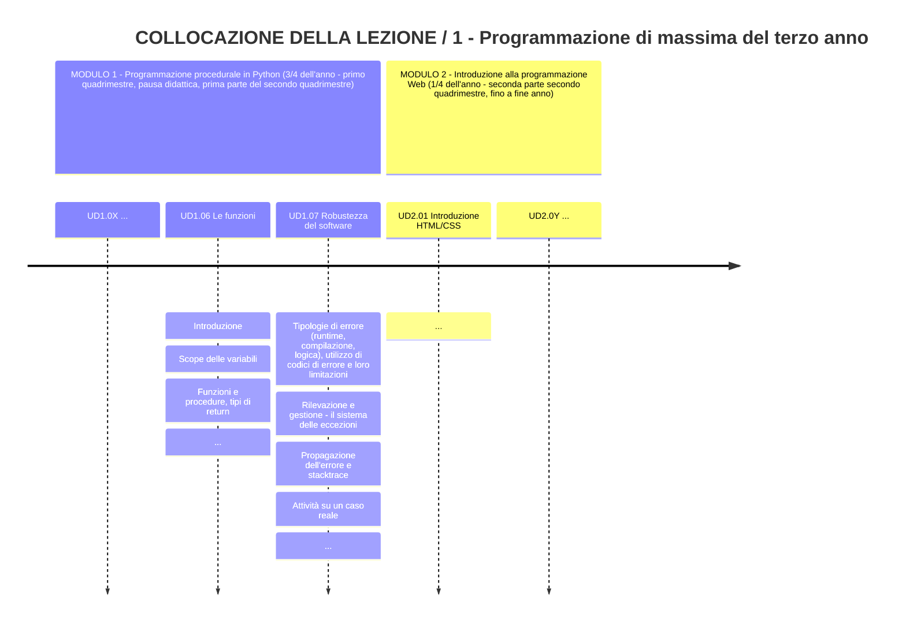
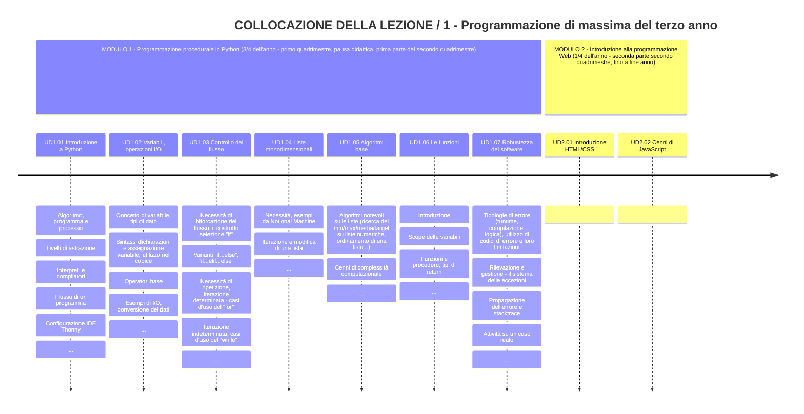
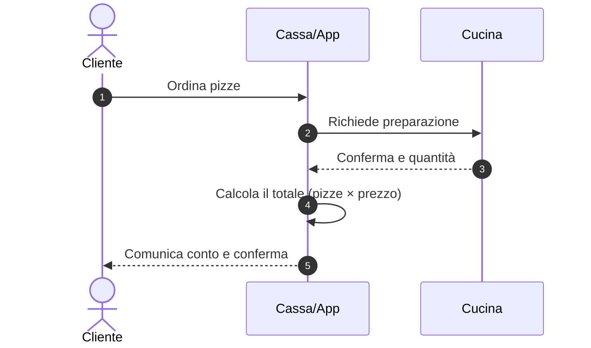

+++

title = "Guide for writing markdown slides"
description = "A Hugo theme for creating Reveal.js presentations"
outputs = ["Reveal"]
aliases = [
    "/guide/"
]

+++

Traccia **#01**

# **Rilevazione** e **gestione** degli **errori** nel codice: <br>le **eccezioni**
#### P.F. 60 CFU · Abilitazione all'insegnamento - esame orale
c.d.c. B016 - Laboratorio di Scienze e Tecnologie Informatiche

<br>

{}
{}
<small><strong>Candidato</strong>: Nicholas Magi</small>
{}
{}
<small><strong>Matricola</strong>: `0001253846` </small>
{}
{}

{} 

---

## Contesto classe

- Classe: **terza**
- Scuola: **Istituto Tecnico**
  - Settore: **Tecnologico**
    - Indirizzo: **Informatica e Telecomunicazioni**
      - Articolazione: **Informatica**
- Disciplina: **Informatica**
- Alunni: **25**
  - di cui *due* **Bisogni Educativi Speciali (BES) con ADHD**

<br>
<br>

> Classe coesa e collaborativa, si riesce a lavorare in un clima disteso ma si rileva una bassa soglia dell'attenzione e frequente necessità di uscire dall'aula.

---

## Contestualizzazione nei <br> documenti ministeriali

<small>

Dal documento: 

**'ISTITUTI TECNICI - LINEE GUIDA PER IL PASSAGGIO AL NUOVO ORDINAMENTO - Secondo biennio e quinto anno - indirizzo "Informatica e Telecomunicazioni"'** 
<br>
allegato alla DIRETTIVA n. 4 del 16/01/2012, applicazione dell'articolo 8, comma 3, del d.P.R. 15 marzo 2010, n. 88. [1]

</small>

<br class="my-5">

{}
{}
#### **Conoscenze**
- Linguaggi e macchine a vari livelli di astrazione.
{}
{}
#### **Abilità**
- Scegliere il tipo di organizzazione dei dati più adatto a gestire le
informazioni in una situazione data.
{}
{}

---
<!--


---
--->



---

## Collocazione della lezione / 2

{}

**#6 - Digital systems are designed by humans to serve human needs.**

<small>*+ possibile correlazione con*</small>

**#5 - Programs express algorithms and data in a form that can be implemented on a
computer.**

{}

---

## Prerequisiti

- Sintassi del linguaggio di programmazione **Python**
- Concetto di algoritmo
- Principali costrutti della programmazione strutturata:
  - costrutto selezione: `if`, `elif`, `else`;
  - costrutto iterazione: `for`, `while`;
- Concetto di **funzione**
  - tipo di ritorno, passaggio dei parametri

---

## Obiettivi specifici di apprendimento in forma operativa

*Al termine dell'attività, lo studente è in grado di:*

<div class="d-flex flex-column gap-1">

<span class="border border-3 rounded-3 py-3 px-5 bg-warning-subtle">

1. **Identificare**, in un breve programma Python dato, i costrutti di rilevazione (`raise`) e gestione (`try/except`), associandoli al rispettivo ruolo (funzione vs chiamante) in tutti i casi proposti.

</span>

<span class="border border-3 rounded-3 py-3 px-5 bg-warning-subtle">

2. **Confrontare** un programma Python che gestisce gli errori tramite valori sentinella con uno che utilizza le eccezioni, indicando almeno due vantaggi della separazione tra rilevazione e gestione rispetto a interfacce diverse.

</span>

</div>

---

## Metodologie <br> didattiche

<br>

{}
{}
##### PERCHÈ?
#### 1. **Pair <br> Programming**
- Riduce il carico cognitivo della sintassi del codice
- Studenti ADHD ricevono supporto dai compagni
{}
{}
##### PERCHÈ?
#### 2. **Necessity Learning Design**
- Lo studente capisce il problema reale che il meccanismo delle eccezioni risolve, senza considerarlo come nozione imposta dal docente.
{}
{}
##### PERCHÈ?
#### 3. **Didattica Unplugged e teatralizzazione**
- Attivazione motoria richiesta per gli studenti con ADHD
- Lezione più dinamica e coinvolgente, soglia dell'attenzione più alta
- Feedback immediato su quello che si sta facendo
{}
{}

---

## Micro-planning dell'attività

La lezione si svolge in compresenza con il collega di classe A041.


---

## Fase 1. Unplugged: La pizzeria a coppie

Esempio di schede distribuite
{}

{}

{}

{}


<small>

 _*massimo **18 pizze**_

</small>
{}

{}

---

## Valutazione formativa

Somministrata tramite **piattaforma digitale dedicata** (*Moodle/custom*)

{}
{}
#### Studenti
- Evidenzia **fragilità** e **punti di forza** della comprensione dell'argomento, fornendo anche una spiegazione - se necessario - sugli errori commessi.
- Il sistema fornisce un **resoconto scaricabile** sull'andamento del test, fornendone una **breve descrizione testuale** 
{}
{}
#### Docenti
- **Feedback istantaneo sull'andamento della classe**;
- Capiscono se occorre riprendere e quanto profondamente i concetti della lezione nella volta successiva; 
{}
{}

---

## **Piano B**: riadattamento dell'attività
Nel caso la valutazione formativa rilevasse **diffuse situazioni di fragilità**.

{}
{}
### Parte di classe <br> **con fragilità**
Per abbassare il carico cognitivo e concentrare tutto sull'utilizzo di eccezioni e sul loro flusso, rendo il codice prodotto un **Parson problem** - da ricomporre e testare su Python Tutor.
{}
{}
### Parte di classe **con poche (o nessuna) fragilità**
Lavorano, guidati dal collega A041, all'estensione di `app()`, aggiungendo qualche funzionalità extra.
{}
{}

---

## Inclusione "by design"

{}
{}
#### Strategie
- **Attività unplugged e micro fasi scandite** per incanalare l'irrequietezza dei 2 studenti BES con ADHD
- **Coppie fisse tutta l'ora** - zero transizioni logistiche;
  - i due studenti BES con ADHD sono inseriti in coppie distinte con partner collaborativi
- **Valutazione libera**, senza ansia da cronometro e con eventuale recupero a basso carico cognitivo
{}
{}
#### Strumenti
- Materiale del docente sempre consultabile per esempi sull'utilizzo del nuovo costrutto
- Report finale scaricabile e consultabile anche in un secondo momento 
{}
{}

---

## Risorse didattiche, attrezzature, spazi

- Laboratorio
  - almeno una postazione per coppia (meglio se ognuno dotato di suo dispositivo)
- Lavagna (anche non LIM)
- Proiettore
- Fogli di carta e penne
- Slides del docente
- pythontutor.com

---



Istituto Tecnico Tecnologico "..." @ Cesena (FC)
# Gestione e rilevazione degli errori in Python

{}
<br>
<small>

A cura di Nicholas Magi - `nicholas.magi[at]...[dot]it`

</small>

---



## Attività

Simuliamo il flusso di un'applicazione che permette ad un utente di ordinare pizze.

Per semplicità, non specifichiamo il gusto della pizza e sappiamo che tutte costano **€8**.

<br>

### Organizzazione
Classe divisa in **coppie**, dove ciascun individuo ha un **ruolo**:

{}
{}
#### **(A) Cassiere+app** 
Si interfaccia con l'utente, riceve la sua ordinazione (quante pizze vuole) e gli restituisce il totale da pagare.
{}
{}
#### **(B) Cuoco**
Riceve la comanda dal cassiere, controlla se può soddisfare l'ordine e restituisce il numero di pizze preparate. **Se si verifica un problema durante la preparazione, si impegna comunque a restituire un numero**.
{}
{}

> Per il trio: riuscite a spezzare "**cassiere**" da "**app**"

---



## Una **schematizzazione** 



---



## **Simulazione**: 
**Ordine #01**: 2 pizze!

---

{}



## **CUCINA: Tocca a voi!**

{}
{}

#### Ordine #01 
5 pizze!

{}

{}
<iframe src="https://didattica-nm.github.io/countdown/" class="w-full" height="800" width="1000"></iframe>
{}

{}

---



## **CUCINA: Tocca a voi!**

{}
{}

#### Ordine #01 
5 pizze!

#### Ordine #02 
4 pizze!

{}

{}
<iframe src="https://didattica-nm.github.io/countdown/" class="w-full" height="800" width="1000"></iframe>
{}

{}

---



## **CUCINA: Tocca a voi!**

{}
{}

#### Ordine #01 
5 pizze!

#### Ordine #02 
4 pizze!

#### Ordine #03 
10 pizze!

{}

{}
<iframe src="https://didattica-nm.github.io/countdown/" class="w-full" height="800" width="1000"></iframe>
{}

{}

---



## **CUCINA: Tocca a voi!**

{}
{}

#### Ordine #01 
5 pizze!

#### Ordine #02 
4 pizze!

#### Ordine #03 
10 pizze!

#### Ordine #04 
12 pizze!

{}

{}
<iframe src="https://didattica-nm.github.io/countdown/" class="w-full" height="800" width="1000"></iframe>
{}

{}

---



## **CUCINA: Tocca a voi!**

{}
{}

#### Ordine #01 
5 pizze!

#### Ordine #02 
4 pizze!

#### Ordine #03 
10 pizze!

#### Ordine #04 
12 pizze!

#### Ordine #05 
7 pizze!

{}

{}
<iframe src="https://didattica-nm.github.io/countdown/" class="w-full" height="800" width="1000"></iframe>
{}

{}

{}

---



## Totali raccolti per ogni ordine?

{}

*Secondo i miei calcoli...*

| Ordine #01 	| Ordine #02 	| Ordine #03 	| Ordine #04 	| Ordine #05 	|
|:------------:	|:------------:	|:------------:	|:------------:	|:------------:	|
| €40        	| €32        	| <mark>€72 (**??**)</mark>   	| <mark>€0 (**??**)</mark>    	| <mark>€0 (**??**)</mark>    	|

<br>

- Per **ordine #03** mi aspettavo **€80**!
- Per **ordine #04** mi aspettavo **€92**!
- Per **ordine #05** mi aspettavo **€56**!

{}

---



## Cassiere+App: La cucina ha avuto dei problemi...

L'unico modo per segnalarvelo è stato tramite il risultato condiviso all'utente!

---



## Pessima pratica

*Mescolare* la **rilevazione dell'errore** con il **flusso dei dati** crea confusione! <br>
(*e tanti altri problemi*)
<br>

Dubbi come: 
> ma il valore che leggo è effettivamente quello che il programma doveva restituirmi oppure è il risultato di un errore da gestire?

---



## Come potremmo ovviare?

{}

Potremmo pensare ad un *flusso dell'errore* **separato** da quello dei *dati*!

{}

---



## Nuova regola: la "**carta dell'errore**"

{}
{}

{}
{}

### Cucina
D'ora in poi, se la cucina ha qualche problema è autorizzata a lanciarvi in testa la carta dell'errore.
(*attenzione a non essere troppo maneschi*)

<br>

È inoltre libera di aggiungere un piccolo post-it che indichi, con una **<u>brevissima</u> descrizione**, la natura del problema (p.e. "Pizzaiolo KO")
{}
{}

### Cassiere+App

Quando ricevete un **risultato anomalo** della cucina (*ora opportunamente segnalato*), mostratelo all'utente!
{}
{}

---



## **Proviamo di nuovo!**

---

{}



## **CUCINA: Tocca a voi!**

{}
{}

#### Ordine #01 
5 pizze!

{}

{}
<iframe src="https://didattica-nm.github.io/countdown/" class="w-full" height="800" width="1000"></iframe>
{}

{}

---



## **CUCINA: Tocca a voi!**

{}
{}

#### Ordine #01 
5 pizze!

#### Ordine #02 
4 pizze!

{}

{}
<iframe src="https://didattica-nm.github.io/countdown/" class="w-full" height="800" width="1000"></iframe>
{}

{}

---



## **CUCINA: Tocca a voi!**

{}
{}

#### Ordine #01 
5 pizze!

#### Ordine #02 
4 pizze!

#### Ordine #03 
10 pizze!

{}

{}
<iframe src="https://didattica-nm.github.io/countdown/" class="w-full" height="800" width="1000"></iframe>
{}

{}

---



## **CUCINA: Tocca a voi!**

{}
{}

#### Ordine #01 
5 pizze!

#### Ordine #02 
4 pizze!

#### Ordine #03 
10 pizze!

#### Ordine #04 
12 pizze!

{}

{}
<iframe src="https://didattica-nm.github.io/countdown/" class="w-full" height="800" width="1000"></iframe>
{}

{}

---



## **CUCINA: Tocca a voi!**

{}
{}

#### Ordine #01 
5 pizze!

#### Ordine #02 
4 pizze!

#### Ordine #03 
10 pizze!

#### Ordine #04 
12 pizze!

#### Ordine #05 
7 pizze!

{}

{}
<iframe src="https://didattica-nm.github.io/countdown/" class="w-full" height="800" width="1000"></iframe>
{}

{}

{}

---


## (*nuovi*) Totali raccolti per ogni ordine?

{}

*Secondo i miei calcoli...*

| Ordine #01 	| Ordine #02 	| Ordine #03 	| Ordine #04 	| Ordine #05 	|
|:------------:	|:------------:	|:------------:	|:------------:	|:------------:	|
| €40        	| €32        	| ~€72~   	| ~€0~    	| ~€0~    	|

<br>

- Per **ordine #03** ricevo **carta errore** - post-it *"Ingredienti KO"*
- Per **ordine #04** ricevo **carta errore** - post-it *"Forno KO"*
- Per **ordine #05** ricevo **carta errore** - post-it *"Forno KO"*

{}

---



## In un'applicazione reale...


---



## Back to **Python**

```python { linenos="inline" }
import random
PREZZO_PIZZA = 8
pizze_disponibili = 5

# 1. RILEVAZIONE (Cucina: controlla le regole e prepara le pizze)
def cucina(num_pizze):
    global pizze_disponibili
    forno_acceso = random.choice([True, False])
    if not forno_acceso:
        return 0
    if num_pizze > pizze_disponibili:
        return 0
    pizze_disponibili -= num_pizze
    return num_pizze

# 2. LIVELLO INTERMEDIO (Cassiere: calcola il conto, nessun controllo errori)
def cassiere(num_pizze):
    pizze_pronte = cucina(num_pizze)
    totale = pizze_pronte * PREZZO_PIZZA
    return totale

# 3. GESTIONE (App Cliente: parla con l'utente e gestisce gli errori)
def app(num_pizze):
    conto = cassiere(num_pizze)
    print("App -> Ordine confermato! Totale:", conto, "euro")

app(2) # Cosa stampa? Provate con i numeri degli ordini di prima
app(4) # Cosa stampa? Provate con i numeri degli ordini di prima
```

Proviamo a seguire il flusso su [**[Python Tutor]**](https://pythontutor.com/visualize.html#code=import%20random%0APREZZO_PIZZA%20%3D%208%0Apizze_disponibili%20%3D%205%0A%0A%23%201.%20RILEVAZIONE%20%28Cucina%3A%20controlla%20le%20regole%20e%20prepara%20le%20pizze%29%0Adef%20cucina%28num_pizze%29%3A%0A%20%20%20%20forno_acceso%20%3D%20random.choice%28%5BTrue,%20False%5D%29%0A%20%20%20%20if%20not%20forno_acceso%3A%0A%20%20%20%20%20%20%20%20return%200%0A%20%20%20%20if%20num_pizze%20%3E%20pizze_disponibili%3A%0A%20%20%20%20%20%20%20%20return%200%0A%20%20%20%20num_pizze%20-%3D%201%0A%20%20%20%20return%20num_pizze%0A%0A%23%202.%20LIVELLO%20INTERMEDIO%20%28Cassiere%3A%20calcola%20il%20conto,%20nessun%20controllo%20errori%29%0Adef%20cassiere%28num_pizze%29%3A%0A%20%20%20%20pizze_pronte%20%3D%20cucina%28num_pizze%29%0A%20%20%20%20totale%20%3D%20pizze_pronte%20*%20PREZZO_PIZZA%0A%20%20%20%20return%20totale%0A%0A%23%203.%20GESTIONE%20%28App%20Cliente%3A%20parla%20con%20l'utente%20e%20gestisce%20gli%20errori%29%0Adef%20app%28num_pizze%29%3A%0A%20%20%20%20conto%20%3D%20cassiere%28num_pizze%29%0A%20%20%20%20print%28%22App%20-%3E%20Ordine%20confermato!%20Totale%3A%22,%20conto,%20%22euro%22%29%0A%0Aapp%282%29%20%23%20Cosa%20stampa%3F%20Provate%20con%20i%20numeri%20degli%20ordini%20di%20prima%0Aapp%284%29%20%23%20Cosa%20stampa%3F%20Provate%20con%20i%20numeri%20degli%20ordini%20di%20prima&mode=edit&origin=opt-frontend.js&primitivesAsObjects=true&py=311)

---



## Dove **rilevo** l'errore?

```python { linenos="inline" hl_lines=["9-12"] }
import random
PREZZO_PIZZA = 8
pizze_disponibili = 5

# 1. RILEVAZIONE (Cucina: controlla le regole e prepara le pizze)
def cucina(num_pizze):
    global pizze_disponibili
    forno_acceso = random.choice([True, False])
    if not forno_acceso:
        return 0
    if num_pizze > pizze_disponibili:
        return 0
    pizze_disponibili -= num_pizze
    return num_pizze

# 2. LIVELLO INTERMEDIO (Cassiere: calcola il conto, nessun controllo errori)
def cassiere(num_pizze):
    pizze_pronte = cucina(num_pizze)
    totale = pizze_pronte * PREZZO_PIZZA
    return totale

# 3. GESTIONE (App Cliente: parla con l'utente e gestisce gli errori)
def app(num_pizze):
    conto = cassiere(num_pizze)
    print("App -> Ordine confermato! Totale:", conto, "euro")

app(2) # Cosa stampa? Provate con i numeri degli ordini di prima
app(4) # Cosa stampa? Provate con i numeri degli ordini di prima
```

---



## Dove (dovrei) **gestire** l'errore?

```python { linenos="inline" hl_lines=["24-25"] }
import random
PREZZO_PIZZA = 8
pizze_disponibili = 5

# 1. RILEVAZIONE (Cucina: controlla le regole e prepara le pizze)
def cucina(num_pizze):
    global pizze_disponibili
    forno_acceso = random.choice([True, False])
    if not forno_acceso:
        return 0
    if num_pizze > pizze_disponibili:
        return 0
    pizze_disponibili -= num_pizze
    return num_pizze

# 2. LIVELLO INTERMEDIO (Cassiere: calcola il conto, nessun controllo errori)
def cassiere(num_pizze):
    pizze_pronte = cucina(num_pizze)
    totale = pizze_pronte * PREZZO_PIZZA
    return totale

# 3. GESTIONE (App Cliente: parla con l'utente e gestisce gli errori)
def app(num_pizze):
    conto = cassiere(num_pizze)
    print("App -> Ordine confermato! Totale:", conto, "euro")

app(2) # Cosa stampa? Provate con i numeri degli ordini di prima
app(4) # Cosa stampa? Provate con i numeri degli ordini di prima
```

---



## Le **eccezioni** in Python

{}
{}
### Rilevazione <br> `raise ValueError()`

Istruzione utilizzata per **lanciare un errore**.

- Dentro alle parentesi di `ValueError()` posso passare una stringa che indica il **messaggio dell'errore**
  - *come il breve post-it di prima!*

```py { linenos="inline" hl_lines=[3] }
def divisione(numeratore, denominatore):
    if denominatore == 0:
        raise ValueError("Non posso dividere per 0!")
    return numeratore / denominatore
```

{}
{}
### Gestione <br> `try/except`

Prova a fare qualcosa di rischioso in `try`, gestisci l'errore in `except`.

```py { linenos="inline" hl_lines=["6-11"] }
def divisione(numeratore, denominatore):
    if denominatore == 0:
        raise ValueError("Non posso dividere per 0!")
    return numeratore / denominatore

try:
    risultato = divisione(3, 0)
    print("Ho diviso 3 per 0, ho ottenuto", risultato)
except ValueError as errore:
    print("No! Qualcosa " +
    " è andato storto durante la divisione:", errore)
```

{}
{}

---



## Il codice di prima, <br> con la **rilevazione degli errori**

```python { linenos="inline" hl_lines=["9-12"] }
import random
PREZZO_PIZZA = 8
pizze_disponibili = 5

# 1. RILEVAZIONE (Cucina: controlla le regole e prepara le pizze)
def cucina(num_pizze):
    global pizze_disponibili
    forno_acceso = random.choice([True, False])
    if not forno_acceso:
        raise ValueError("Forno KO")
    if num_pizze > pizze_disponibili:
        raise ValueError("Ingredienti KO")
    pizze_disponibili -= num_pizze
    return num_pizze

# 2. LIVELLO INTERMEDIO (Cassiere: calcola il conto, nessun controllo errori)
def cassiere(num_pizze):
    pizze_pronte = cucina(num_pizze)
    totale = pizze_pronte * PREZZO_PIZZA
    return totale

# 3. GESTIONE (App Cliente: parla con l'utente e gestisce gli errori)
def app(num_pizze):
    conto = cassiere(num_pizze)
    print("App -> Ordine confermato! Totale:", conto, "euro")

app(2) # Cosa stampa? Provate con i numeri degli ordini di prima
app(4) # Cosa stampa? Provate con i numeri degli ordini di prima
```

---



## Come posso implementare <br> la **gestione dell'errore**?

```python { linenos="inline" }
import random
PREZZO_PIZZA = 8
pizze_disponibili = 5

# 1. RILEVAZIONE (Cucina: controlla le regole e prepara le pizze)
def cucina(num_pizze):
    global pizze_disponibili
    forno_acceso = random.choice([True, False])
    if not forno_acceso:
        raise ValueError("Forno KO")
    if num_pizze > pizze_disponibili:
        raise ValueError("Ingredienti KO")
    pizze_disponibili -= num_pizze
    return num_pizze

# 2. LIVELLO INTERMEDIO (Cassiere: calcola il conto, nessun controllo errori)
def cassiere(num_pizze):
    pizze_pronte = cucina(num_pizze)
    totale = pizze_pronte * PREZZO_PIZZA
    return totale

# 3. GESTIONE (App Cliente: parla con l'utente e gestisce gli errori)
def app(num_pizze):
    conto = cassiere(num_pizze)
    print("App -> Ordine confermato! Totale:", conto, "euro")

app(2) # Cosa stampa? Provate con i numeri degli ordini di prima
app(4) # Cosa stampa? Provate con i numeri degli ordini di prima
```

---



## E se, in `cucina(num_pizze)`, <br>`num_pizze` $\leq 0$?

```python { linenos="inline" }
import random
PREZZO_PIZZA = 8
pizze_disponibili = 5

# 1. RILEVAZIONE (Cucina: controlla le regole e prepara le pizze)
def cucina(num_pizze):
    global pizze_disponibili
    forno_acceso = random.choice([True, False])
    if not forno_acceso:
        raise ValueError("Forno KO")
    if num_pizze > pizze_disponibili:
        raise ValueError("Ingredienti KO")
    pizze_disponibili -= num_pizze
    return num_pizze

# 2. LIVELLO INTERMEDIO (Cassiere: calcola il conto, nessun controllo errori)
def cassiere(num_pizze):
    pizze_pronte = cucina(num_pizze)
    totale = pizze_pronte * PREZZO_PIZZA
    return totale

# 3. GESTIONE (App Cliente: parla con l'utente e gestisce gli errori)
def app(num_pizze):
    try:
        conto = cassiere(num_pizze)
        print("App -> Ordine confermato! Totale:", conto, "euro")
    except ValueError as errore:
        print("App -> Errore! Ordine non confermato:", errore)

app(2) # Cosa stampa? Provate con i numeri degli ordini di prima
app(4) # Cosa stampa? Provate con i numeri degli ordini di prima
```

---



```python { linenos="inline" hl_lines=["13-14", "26-30"] }
import random
PREZZO_PIZZA = 8
pizze_disponibili = 5

# 1. RILEVAZIONE (Cucina: controlla le regole e prepara le pizze)
def cucina(num_pizze):
    global pizze_disponibili
    forno_acceso = random.choice([True, False])
    if not forno_acceso:
        raise ValueError("Forno KO")
    if num_pizze > pizze_disponibili:
        raise ValueError("Ingredienti KO")
    if num_pizze <= 0:
        raise ValueError("Richiesto un numero invalido di pizze")
    pizze_disponibili -= num_pizze
    return num_pizze

# 2. LIVELLO INTERMEDIO (Cassiere: calcola il conto, nessun controllo errori)
def cassiere(num_pizze):
    pizze_pronte = cucina(num_pizze)
    totale = pizze_pronte * PREZZO_PIZZA
    return totale

# 3. GESTIONE (App Cliente: parla con l'utente e gestisce gli errori)
def app(num_pizze):
    try:
        conto = cassiere(num_pizze)
        print("App -> Ordine confermato! Totale:", conto, "euro")
    except ValueError as errore:
        print("App -> Errore! Ordine non confermato:", errore)

app(2) # Cosa stampa? Provate con i numeri degli ordini di prima
app(4) # Cosa stampa? Provate con i numeri degli ordini di prima
```

Proviamo a seguire il flusso su [**[Python Tutor]**](https://pythontutor.com/)