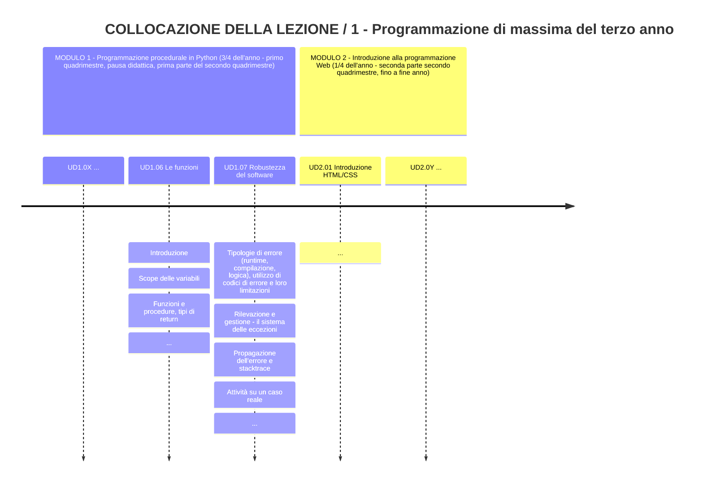
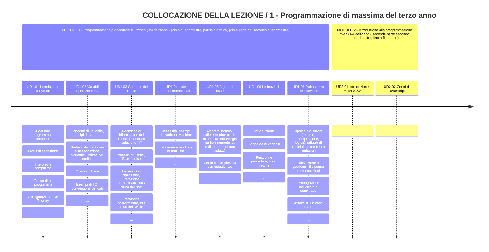

+++

title = "Guide for writing markdown slides"
description = "A Hugo theme for creating Reveal.js presentations"
outputs = ["Reveal"]
aliases = [
    "/guide/"
]

+++

Traccia **#01**

# **Rilevazione** e **gestione** degli **errori** nel codice:  le **eccezioni**
#### P.F. 60 CFU · Abilitazione all'insegnamento - esame orale
c.d.c. B016 - Laboratorio di Scienze e Tecnologie Informatiche

 

{}
{}
<small><strong>Candidato</strong>: Nicholas Magi</small>
{}
{}
<small><strong>Matricola</strong>: `0001253846` </small>
{}
{}

{} 

---

## Contesto classe

- Classe: **terza**
- Scuola: **Istituto Tecnico**
  - Settore: **Tecnologico**
    - Indirizzo: **Informatica e Telecomunicazioni**
      - Articolazione: **Informatica**
- Disciplina: **Informatica**
- Alunni: **25**
  - di cui *due* **Bisogni Educativi Speciali (BES) con ADHD**

 
 

> Classe coesa e collaborativa, si riesce a lavorare in un clima disteso ma si rileva una bassa soglia dell'attenzione e frequente necessità di uscire dall'aula.

---

## Contestualizzazione nei   documenti ministeriali

<small>

Dal documento: 

**'ISTITUTI TECNICI - LINEE GUIDA PER IL PASSAGGIO AL NUOVO ORDINAMENTO - Secondo biennio e quinto anno - indirizzo "Informatica e Telecomunicazioni"'** 
 
allegato alla DIRETTIVA n. 4 del 16/01/2012, applicazione dell'articolo 8, comma 3, del d.P.R. 15 marzo 2010, n. 88. [1]

</small>

 

{}
{}
#### **Conoscenze**
- Linguaggi e macchine a vari livelli di astrazione.
{}
{}
#### **Abilità**
- Scegliere il tipo di organizzazione dei dati più adatto a gestire le
informazioni in una situazione data.
{}
{}

---

---

---

## Collocazione della lezione / 2

{}

**#6 - Digital systems are designed by humans to serve human needs.**

<small>*+ possibile correlazione con*</small>

**#5 - Programs express algorithms and data in a form that can be implemented on a
computer.**

{}

---

## Prerequisiti

- Sintassi del linguaggio di programmazione **Python**
- Concetto di algoritmo
  - saper implementare alcuni *algoritmi notevoli* (ricerca di min/max/elemento all'interno di una lista, determinare se un numero $n$ è primo...)
- Principali costrutti della programmazione strutturata:
  - costrutto selezione: `if`, `elif`, `else`;
  - costrutto iterazione: `for`, `while`;
- Concetto di **funzione**

---

## Obiettivi specifici di apprendimento in forma operativa

*Al termine dell'attività, lo studente è in grado di:*

#01) **Identificare**, dato un breve programma Python con costrutti dedicati alla rilevazione (`raise`) e quelli dedicati alla gestione (`try/except`) degli errori, tali costrutti e associare ciascun costrutto al rispettivo ruolo (funzione chiamata vs programma chiamante) in tutti i casi proposti.

#02) **Prevedere** l'output e il flusso di esecuzione di un breve programma Python che utilizza `raise` e `try/except` a fronte di input validi e non validi, indicando correttamente se l'eccezione viene intercettata o se provoca la terminazione del programma in almeno 3 casi di test su 4.

#03) **Usare** i costrutti `raise ValueError` e `try/except`, dato un breve programma Python guidato (con checklist operativa), per sostituirli ai controlli realizzati con `print` e valori sentinella in modo che il codice separi rilevazione e gestione e superi tutti i casi di test dati senza terminazioni anomale.

---

## Micro-planning dell'attività

La lezione si svolge in compresenza con il collega di classe A041.

| Fase 	| Docente 	| Studenti 	| Tempi 	|
|------	|---------	|----------	|-------	|
| 1.     	|         	|          	|       	|
| 2.     	|         	|          	|       	|
| 3.     	|         	|          	|       	|
| 4.     	|         	|          	|       	|

---

## Metodologie   didattiche

 

{}
{}
#### 1. Pair   Programming
{}
{}
#### 2. Necessity Learning Design
{}
{}
#### 3. Unplugged
{}
{}

---

## Valutazione formativa

{}
{}
#### Docenti

{}
{}
#### Studenti

{}
{}

---

## Piano B: riadattamento dell'attività
Nel caso la valutazione formativa rilevasse **diffuse situazioni di fragilità**.

---

## Inclusione "by design"

{}
{}
#### Strategie

{}
{}
#### Strumenti

{}
{}

---

## Risorse didattiche, attrezzature, spazi

---

## Bibliografia

---

## Micro-planning dell'attività

La lezione si svolge in compresenza con il collega di classe A041.

| Fase 	| Docente 	| Studenti 	| Tempi 	|
|------	|---------	|----------	|-------	|
| 1.     	|         	|          	|       	|
| 2.     	|         	|          	|       	|
| 3.     	|         	|          	|       	|
| 4.     	|         	|          	|       	|

---



Istituto Tecnico Tecnologico "..." @ Cesena (FC)
# Gestione e rilevazione dell'errore in Python

{}
 
<small>

A cura di Nicholas Magi - `nicholas.magi[at]...[dot]com`

</small>

---


